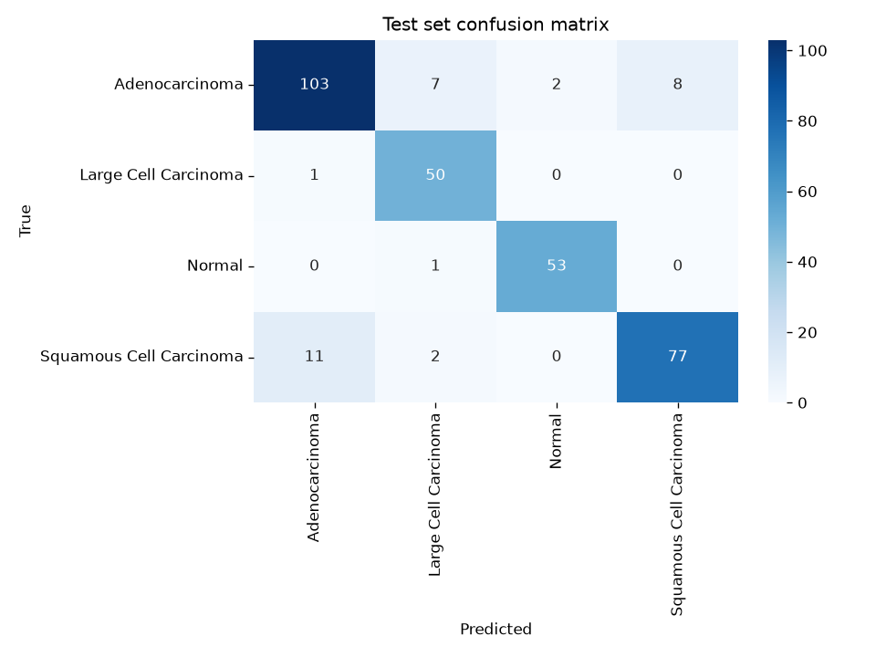
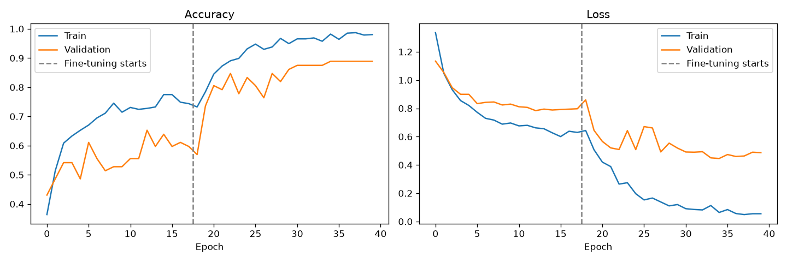
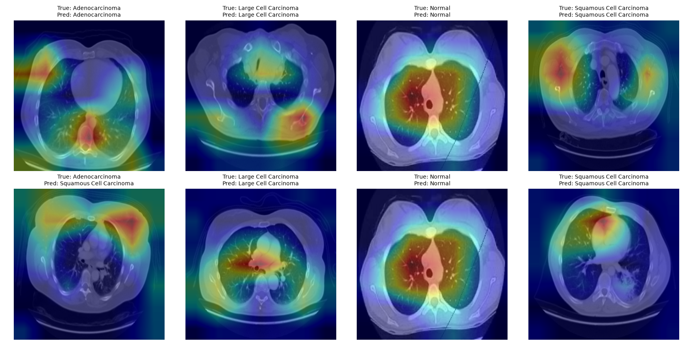

# Lung Cancer CT Classifier

Deep learning classifier that detects lung cancer subtypes in chest CT scans, packaged in a desktop app.

Given a CT slice, the model predicts one of four classes:

| Class | Description |
|---|---|
| Adenocarcinoma | Most common non-small-cell lung cancer, usually in outer lung regions |
| Large Cell Carcinoma | Fast-growing undifferentiated carcinoma |
| Squamous Cell Carcinoma | Typically found centrally, near the bronchi |
| Normal | No cancer present |

## Results

Evaluated on the held-out test set (315 images, never used for training or model selection):

| Model | Train acc | Val acc | **Test acc** | **Test macro-F1** |
|---|---|---|---|---|
| Baseline CNN from scratch ([LKHA.ipynb](LKHA.ipynb)) | 99.8% | 84.7% | 53.0% | — |
| EfficientNetB0, light fine-tuning (top 40 layers, LR 1e-5) | ~80% | 66.7% | 75.6% | 0.769 |
| **EfficientNetB0, full fine-tuning (top 100 layers, LR 1e-4)** | ~98% | 88.9% | **89.8%** | **0.907** |

Per-class results for the final model:

| Class | Precision | Recall (sensitivity) | F1 | Test images |
|---|---|---|---|---|
| Adenocarcinoma | 0.896 | 0.858 | 0.877 | 120 |
| Large Cell Carcinoma | 0.833 | 0.980 | 0.901 | 51 |
| Normal | 0.964 | 0.981 | 0.972 | 54 |
| Squamous Cell Carcinoma | 0.906 | 0.856 | 0.880 | 90 |



Most remaining errors are adenocarcinoma and squamous cell carcinoma confused with each other. These two non-small-cell subtypes are also the hardest pair to tell apart visually.



**Grad-CAM** (where the model looks when it makes a prediction):



### Limitations

- **Small dataset.** 613 training images and only 72 for validation, so validation accuracy jumps around by several points between epochs.
- **Possible dataset shortcut.** The "Normal" scans appear to come from a different source from the cancer scans (different framing, plus a visible line artefact). The near-perfect Normal scores may partly reflect the model recognising the image source rather than the anatomy. Some test images also look like near-duplicates.
- **Grad-CAM is mixed.** Many heatmaps focus on lung parenchyma and the hilum, but some highlight the chest wall. That suggests the model hasn't learned purely clinical features.
- **Single 2D slices.** Real diagnosis uses full 3D CT volumes plus clinical context.

## Approach

**Baseline ([LKHA.ipynb](LKHA.ipynb)).** A 3-block CNN trained from scratch (44M parameters, most of them in the dense layer after `Flatten`). It memorised the 613 training images (99.8% train accuracy) but generalised poorly (53% test accuracy).

**Transfer learning ([train.py](train.py)).** Fixes the overfitting with:

- **EfficientNetB0 pretrained on ImageNet** as a feature extractor, with global average pooling in place of `Flatten` (~4M parameters)
- **Two-phase training:** first only the new classification head is trained with the backbone frozen, then the top 100 backbone layers are fine-tuned at LR 1e-4 (BatchNorm stays frozen)
- **Data augmentation:** small rotations, zoom, translation and contrast changes
- **Class weighting** for the imbalanced training set
- **Early stopping and LR reduction** on validation loss
- **Grad-CAM** heatmaps to check the model is looking at lung tissue rather than artefacts

**Evaluation.** Classification metrics (per-class precision/recall/F1, macro F1, confusion matrix) on a held-out test set that is never used during training or model selection.

## Dataset

[Chest CT-Scan images dataset](https://www.kaggle.com/datasets/mohamedhanyyy/chest-ctscan-images) (Kaggle), 1,000 PNG images:

| Split | Adenocarcinoma | Large cell | Normal | Squamous cell | Total |
|---|---|---|---|---|---|
| train | 195 | 115 | 148 | 155 | 613 |
| valid | 23 | 21 | 13 | 15 | 72 |
| test | 120 | 51 | 54 | 90 | 315 |

## Project structure

```
├── train.py                 # transfer-learning training + evaluation (writes models/ and results/)
├── LKHA.ipynb / LKHA.py     # baseline CNN notebook and its script export
├── src/
│   ├── main.py              # desktop app entry point (login -> classifier)
│   ├── XrayClassifierGUI.py # image upload and prediction screen
│   ├── model.py             # model loading and inference
│   ├── image_processing.py  # OpenCV preprocessing
│   └── login_screen.py, register_screen.py
├── train/ valid/ test/      # dataset, one folder per class
├── models/                  # trained model (generated, git-ignored)
└── results/                 # metrics and plots (generated)
```

## Getting started

Requires Python 3.10+.

```bash
python -m venv .venv
# Windows
.venv\Scripts\activate
# macOS / Linux
source .venv/bin/activate

pip install -r requirements.txt
```

**Train the model** (about 25 minutes on a laptop CPU):

```bash
python train.py
```

This saves `models/model.keras` and writes metrics and plots to `results/`.

**Run the desktop app:**

```bash
cd src
python main.py
```

Log in, click **Load Image** and pick any CT scan from `test/`. The app shows the preprocessed image and the predicted class with its confidence.

## Disclaimer

Research and educational project only. Not a medical device, and not for clinical diagnosis.
